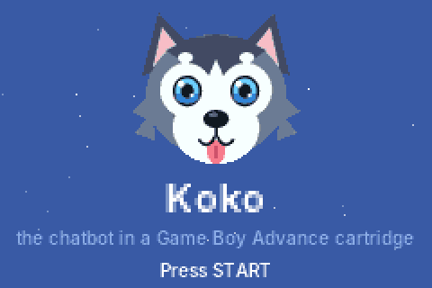

# Koko the Chatbot

A language model that runs entirely on an unmodified Game Boy Advance. Koko, a friendly husky, chats, tells
short stories and jokes, suggests your next word while you type, and answers simple questions, at about three
tokens a second on the console's 16.78 MHz processor. There is no extra chip and nothing is sent anywhere: 72
million two-bit weights, lookup tables, a 16,384-token tokenizer and a fact table fill a 32 MB cartridge.

The same C engine is compiled three ways: for the GBA, natively (the reference the ROM is tested against, number
for number) and to WebAssembly for the browser version.

## Play
- **Emulator:** open [`release/koko.gba`](release/koko.gba) in [mGBA](https://mgba.io) or another Game Boy
  Advance emulator.
- **Real console:** copy `release/koko.gba` to a flash cartridge that takes 32 MB ROMs. It has run on a real Game
  Boy Advance this way. The cartridge header's boot-logo field is left blank (no Nintendo data is included);
  emulators and flash cartridges accept that, a console booting the ROM directly would not.
- **Browser:** `web/site/` is the complete browser version (a static page, `koko.wasm` and the 32 MB `koko.bin`).
  Serve it with any static web server, for example `python3 -m http.server -d web/site 8000`, and open
  http://localhost:8000.

Controls, what Koko can and cannot do, and measured numbers are in [release/README.md](release/README.md).

| Button | What it does |
|---|---|
| START | Start; send your message; on an empty line, offer a ready-made message |
| D-pad, A | Move around the on-screen keyboard and type |
| B | Delete a letter; stop Koko while it is writing |
| SELECT | Capital letters on and off |
| L / R | Accept the first / second suggested word |

In the browser: type on your keyboard, Enter is START, Tab and Shift+Tab are L and R, Esc is B.

## What is in this repository
| Folder | What is in it |
|---|---|
| `release/` | **The playable ROM `koko.gba`**, the player README, credits, screenshots and the itch.io page text |
| `engine/` | The cartridge: inference engine (`koko.c`), tokenizer, sums, fact table, screen (`ui.c`), game (`game.c`), ARM kernels, the exporter, and the bit-exact references the engine is checked against (`ref_float.py`, `ref_int.py`). `DESIGN.md` is the running design log |
| `web/` | The browser version: `koko_web.c` (the engine compiled to WebAssembly), the page in `site/` (**including `koko.bin`, the cartridge data with the final weights**), and its tests |
| `train/` | Model definition (`model.py`, `quant.py`) and training code (PyTorch), configs, launchers, and the results of every training run (`results/`) |
| `gen/` | Generation and filtering of Koko's own training conversations, fact drills; generated C headers (`koko_layout.h`, `font_ui.h`, `husky.h`) |
| `study/` | Post-training studies: fast output step, fact recall, sampling |
| `scoreboard/` | Comparison with GPT-2, SmolLM2 and TinyStories models (scripts, results, judge transcripts, `page/scoreboard.html`) |
| `research/` | Results and notes from each stage, including reading notes on published work |
| `artifacts/` | The tokenizer (`mix1x/mix1/tok_16384.json`), token counts, and the configs and results of the final runs (`models/*/result.json`) |
| `art/` | Koko's portrait (drawn in code) |
| `host/` | Native test programs built from the cartridge engine |
| `test/` | Headless mGBA driver (`runner.c`) and the stage-1 ROM test |
| `bench/` | The ternary lookup kernel (`tern.s`, used by the cartridge) and the timing model for candidate architectures |
| `src/`, `tools/` | Stage 1: TinyStories-260K on the cartridge (the first, stories-only ROM) and its tools |

## Build and test
Needs `arm-none-eabi-gcc`, a host `gcc`, Python 3 with numpy, and for the tests libmgba (mGBA as a library) and
Node.js. The browser build needs clang with the wasm32 target and wasm-ld. Run everything from the repository root.

    make                    # build/koko.gba from engine/ and the shipped cartridge data, plus the native engine
    make test               # the ROM in mGBA against the native engine (19 checks), and the WebAssembly build (4 prompts)
    make web                # web/site/koko.wasm
    node web/test_browser.cjs   # the real page in headless Chromium (needs Playwright; run `make test` first)

`make` copies `web/site/koko.bin` to `build/koko.bin` and links it into the ROM; the result is byte-identical to
`release/koko.gba`. Other native programs: `make build/tok_test build/sums_test build/facts_test build/suggest_test`.

### Rebuilding the cartridge data from a trained model
The weights ship in integer form inside `web/site/koko.bin` and `release/koko.gba` (licensed CC BY-SA 4.0, see
below). The float PyTorch checkpoint (357 MB) and the training data are not in this repository. With a trained
`model.pt` placed in `artifacts/models/<run>/` (next to its `result.json`) and the tokenised training streams in
`artifacts/mix1x/mix1/`, the pipeline is:

    python3 engine/extract.py <run>      # weights -> integers (engine/params_<run>.pkl)
    python3 study/collect.py ...         # router data for the fast output step (see engine/DESIGN.md)
    python3 engine/outstep.py            # fast output step data
    python3 engine/facts_build.py        # fact table (needs Simple English Wikipedia in train/data/raw/)
    python3 engine/export.py <run>       # build/koko.bin and gen/koko_layout.h
    python3 engine/build_game.py         # build/koko.gba
    python3 engine/check_twin.py         # integer reference == native engine
    python3 engine/test_gba.py 24        # native engine == ROM in mGBA

Training: `python3 -m train.train --config train/configs/<name>.json`; the final model is `i_kd`, a fine-tune of
`h_koko_L8` with its full-precision twin as coach (`train/launch/batch_h.py`, `batch_i.py`). Training text:
`train/corpus.py`, `train/data.py`, `gen/` (conversations written by Qwen2.5-7B-Instruct through vLLM). The research notes in `research/` and
`engine/DESIGN.md` describe each step and what was measured.

`engine/font_gen.py` needs the Inter font installed (set `INTER_DIR` to the folder with `Inter-Medium.otf`).
Stage 1 (`make stage1`) needs `tools/fetch.sh` first, which downloads Andrej Karpathy's stories260K model and the
font8x8 bitmap font into `dl/`.

## Licence
- **Code:** MIT License ([LICENSE](LICENSE)).
- **Model weights, fact table and artwork** (inside `koko.gba` and `koko.bin`, and `art/`, `gen/husky.h`):
  Creative Commons Attribution-ShareAlike 4.0 ([LICENSE-MODEL](LICENSE-MODEL)). The tokenizer files in
  `artifacts/` go with the model and are shared on the same terms.
- The fact table is text from Simple English Wikipedia (CC BY-SA). Training data, font and tools are credited in
  [CREDITS.md](CREDITS.md).
- **Font bitmaps** (`gen/font_ui.h`, drawn from Inter and compiled into the ROM and the browser version): SIL Open
  Font License 1.1 ([LICENSE-OFL](LICENSE-OFL)).

Built with Llama: part of Koko's chat training data (Everyday Conversations) was generated by Meta's Llama 3.1,
licensed under the Llama 3.1 Community License, Copyright © Meta Platforms, Inc. All Rights Reserved.

Game Boy Advance is a trademark of Nintendo. This is an unofficial hobby project, not made or endorsed by
Nintendo. No Nintendo code or data is included.
